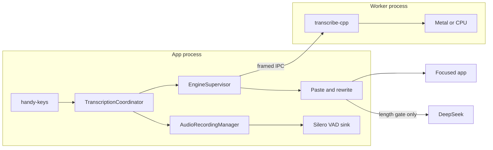
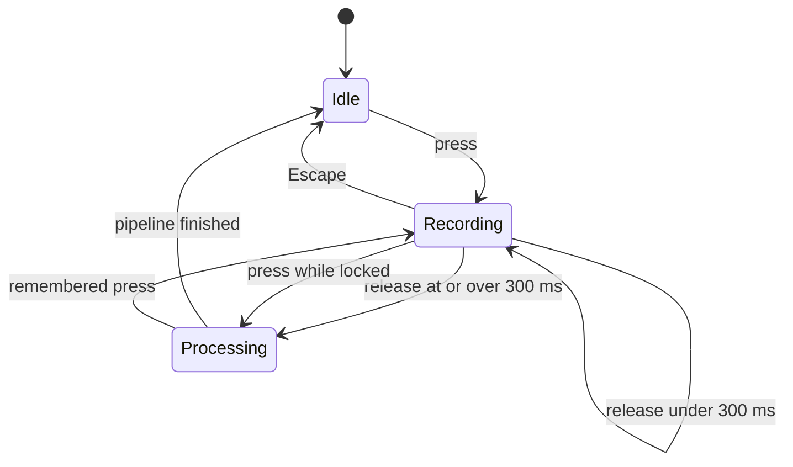
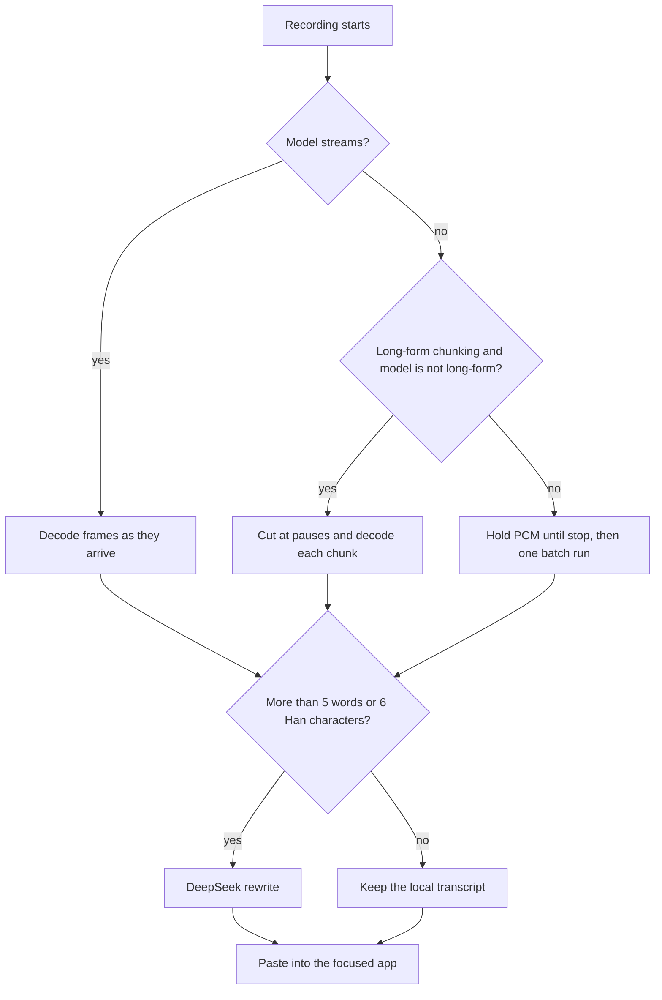

# Penny Flow

Penny Flow is a local-first dictation system. A Rust control plane captures speech, a crash-isolated worker runs a GGUF speech model on the GPU, and a length-gated cloud rewrite cleans the transcript before it is pasted.

The speech model never leaves this Mac. The only network call on the dictation path is an optional DeepSeek rewrite, and only after the local transcript clears a length gate.

## Acknowledgement

The idea and the app started from [Handy](https://github.com/cjpais/Handy), the open-source speech-to-text project by CJ Pais. Local transcription, shortcuts, history, and settings come from that project. Thank you to Handy and everyone who works on it.

Penny Flow is a personal modification, not an official Handy release. Handy is MIT licensed. The copyright and license notice are in `LICENSE`.

## Goal

This is for personal use. When a transcript is longer than five English words, or has more than six Chinese (Han) characters, Penny Flow sends it to DeepSeek. The rewrite drops fillers in English and Chinese, keeps mixed Chinese/English as written, and returns a concise, grammatical result.

The point is a free, or about 95% cheaper, version of the Whisper Flow transcription feature: a local speech model on this machine, plus a small DeepSeek call, instead of a Whisper Flow subscription.

## System design

The app is a Tauri 2 shell. A React settings UI talks to Rust through specta-generated commands. Dictation itself does not go through the webview. A single-threaded coordinator owns the lifecycle, an audio manager owns the microphone, and an engine supervisor owns a child process that is the only place GGML runs.



### Process isolation

All transcribe-cpp work runs in a child of the same binary, relaunched with `--transcribe-worker`. Backend init, device enumeration, model load, and inference stay in that process. A GPU driver fault, a GGML abort, or a hang kills the worker and leaves the UI up.

`EngineSupervisor` is the only owner of that worker. It loads and unloads the model, runs and cancels transcriptions, and if the GPU was at fault retries in a CPU-only worker that never registers GPU backends. At most one worker holds a model. Unload exits the process, so its CPU and GPU memory return to the OS. Listing compute devices may briefly start a second, model-less worker.

The checkout used day to day loads `Qwen3-ASR-0.6B-Q8_0.gguf` on Apple Metal (`MTL0`). The decode policy does not special-case that file. It reads the loaded model's capabilities.

### Shortcut state machine

Global shortcuts come from handy-keys, not the webview. `TranscriptionCoordinator` serializes every press, release, cancel, and pipeline-finished event onto one thread, so a second press cannot race the microphone open.

Activation is hold-or-toggle, with a 300 ms threshold:

- A press that lasts at least 300 ms is push-to-talk. Release stops the recording.
- A shorter press is a tap. The session locks on until the next press.
- A press that arrives while a transcript is still pasting is remembered and started when the pipeline drains. A second tap of that same remembered press forgets it.



Escape is registered only while a recording is active, then unregistered. The recording overlay is a non-activating panel, so showing it does not steal focus from the app that will receive the paste.

### Capture and voice detection

The microphone opens on demand through handy-recorder on CoreAudio. The device rate, often 48 kHz, is resampled to 16 kHz mono and delivered in 512-sample frames, which is one Silero frame (32 ms). The default device is used unless a named microphone is selected. A missing channel falls back to averaging every input channel.

`CaptureSink` runs on the recorder's delivery thread, never the real-time audio callback. It does three things with each frame:

1. Emits a 16-band spectrum, 400 Hz to 4 kHz, to the recording waveform.
2. Feeds Silero VAD (`silero-vad-v6.2-F32.gguf`) through a smoothing wrapper: 60 ms onset, 450 ms pre-roll, 450 ms hangover after speech. Streaming-capable models use a 1650 ms hangover instead.
3. Forwards only the frames the detector calls speech.

If the detector keeps nothing and the take is still clearly audible (peak at least 0.05), the raw PCM is what gets transcribed. A take of digital silence is not sent to the model. The app reports that the microphone delivered nothing, which is what macOS does when Microphone permission does not cover the current signature. Short takes are not padded out with silence. That padding made the speech model return an empty string.

### Decode policy

How a clip is decoded is a pure function of the loaded model and one setting, `long_form_chunking`.



Streaming wins, because that model already handles long audio. Otherwise, when long-form chunking is on and the model is not itself long-form, audio is cut at pauses into chunks of about 30 seconds. A clip of 40 seconds or less stays one chunk. Qwen3-ASR does not stream and is not long-form, so a normal dictation takes the chunked path. The same policy covers a history re-transcription and a file passed on the CLI, except a streaming model then takes the whole clip in one run.

Models that advertise a vocabulary, including Qwen3-ASR, receive saved custom words in the run options. Models that do not advertise it get an empty vocabulary list and the older fuzzy correction, so the engine does not warn on every run.

Language is an intent in settings. Each run resolves that intent against the languages the loaded model actually advertises. The resolved tag is not written back, so switching models does not destroy the intent.

### Rewrite, paste, and the other hotkeys

The local transcript is the source of truth. DeepSeek runs only when `word_count > 5` or the Han ideograph count is greater than 6. Han coverage includes the unified block and extensions A through G. Shorter transcripts paste as the model wrote them, which keeps a one-word correction from paying for a cloud call.

Paste of a transcript honors trailing space, auto-submit, and clipboard handling. Quick paste is a separate path with three saved slots. It inserts the string exactly, restores the previous clipboard, does not append a space, and does not press Enter. `PasteMethod::None` falls back to the platform default so the text still lands.

Text Refine is the same rewrite client aimed at the current selection, with three prompt slots (Option+1/2/3 when enabled). Dictation and refine share one LLM call path, including the Apple Intelligence provider on arm64 macOS.

History stores the wav and the transcript. The default retention drops dictation history after five hours. Lifetime analytics counters live outside that wipe, so deleting old recordings does not zero them.

### What stays on this Mac

| Data | Where | Leaves the machine? |
| --- | --- | --- |
| GGUF speech model | Hugging Face cache, loaded in the worker | No |
| Silero VAD | App resources | No |
| Settings, API key, history | `~/Library/Application Support/com.pais.handy/` | No |
| PCM and transcript | Worker IPC, then local history | No |
| Rewrite request | DeepSeek, and only past the length gate | Yes, the transcript text |

The bundle id stays `com.pais.handy`. Changing it would orphan that Application Support directory. The updater endpoint list is empty and update checks are forced off, so an upstream Handy release cannot replace this app.

## Features

- Local speech-to-text with a length-gated DeepSeek rewrite
- **Text Refine** — select text, press Option+1/2/3 (when enabled), rewrite with a custom prompt
- **Quick paste** — three saved strings, inserted exactly, without the transcript paste policy
- **Analytics** — lifetime counters in Settings (survive the five-hour history wipe)
- Settings, API key, and downloaded models stay under `~/Library/Application Support/com.pais.handy/` (bundle id `com.pais.handy`)

## Run (dev)

From this folder:

```bash
bun tauri dev
```

Add a DeepSeek API key under Settings → Post Process. The key stays in local settings on this Mac. It is not part of this repository.

## Install / update locally

Use the continuity-safe installer so a new build does **not** wipe settings, analytics, or the speech model:

```bash
./install-local.sh --build
```

Or after you already built:

```bash
bun tauri build
./install-local.sh
```

That script:

1. Quits any running Penny Flow
2. Optionally builds the release app
3. Re-signs ad-hoc with entitlements
4. Replaces **only** `/Applications/Penny Flow.app` (never Application Support or `~/.cache/huggingface/`)
5. Launches the new app

You do not re-download the model or re-enter settings unless you delete that Application Support folder yourself. Never change the Tauri `identifier` away from `com.pais.handy` — that would orphan settings.

Microphone / Accessibility / Input Monitoring are tied to the app path and signature. Keeping `/Applications/Penny Flow.app` and the same bundle id maximizes continuity. Ad-hoc signing can still prompt again after some rebuilds; if Accessibility stops working, re-enable Penny Flow once in System Settings — your settings and model are still there.
